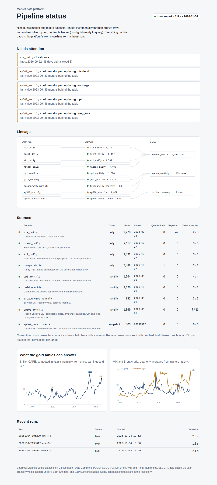

# Market Data Lakehouse

A small data platform that ingests nine public market and macro datasets, then runs them through bronze, silver, and gold layers with contracts, quarantine, incremental merges, freshness monitoring, and an orchestrator. The heavy transform also has a Spark implementation, with a test proving both engines produce identical output.

**Status page:** https://market-data-lakehouse.vercel.app



## What it does

| Layer | What happens | Where |
|---|---|---|
| **Bronze** | Each source is fetched with retries and saved byte for byte, addressed by its SHA-256. An unchanged file is a no-op, and every version ever loaded can be replayed. | `lake/ingest.py` |
| **Silver** | Rows are typed and checked against the source's contract (columns, types, nullability, ranges, unique keys, source-specific rules). Failures go to quarantine with a reason. Valid rows merge incrementally: inserts, revisions to history, and unchanged rows are counted separately. | `lake/silver.py` |
| **Quality** | Freshness by grain, column-level freshness, quarantine rate, row-count drops, and null rates. Each check passes, warns, or blocks. | `lake/quality.py` |
| **Gold** | `market_daily` (VIX, Brent, WTI and gas by trading day), `macro_monthly` (S&P 500 with real returns and Shiller's CAPE), and `sector_summary`. | `lake/gold.py` |
| **Orchestration** | A dependency graph with retries and backoff. Anything downstream of a failure is skipped, never run on stale inputs, and every task's outcome lands in a run log. | `lake/orchestrate.py` |

Today's run holds 42,356 rows across the nine sources.

## What the data quality checks caught

The contracts and checks earned their keep on real data:

- **VIX opening prices before 2003 are unreliable.** 47 days have an open outside that day's high-low range. Dropping those days would lose valid closing prices, so the rows stay, the open is blanked, and each repair is logged.
- **The S&P 500 history writes 0 for "not published yet".** Dividends, earnings, and CPI arrive as zeros for recent months. Zero is a placeholder, not a value, so it becomes null *before* any range check runs. The first version checked ranges first and wrongly quarantined 36 months of valid prices. A test now pins the order.
- **Half of that table quietly stopped updating.** Prices are current, but earnings and dividends end in June 2023. A table-level freshness check passes, because the latest row is recent, so there's a column-level check that flags it. It's the most useful alert on the page.
- **VIX upstream is 43 days stale** while every other daily source is current. The freshness check flags it.
- **WTI really did trade at -$37.63** on April 20, 2020. The contract allows negative prices for that series, because "physically impossible" and "happened once" aren't the same thing.
- **Natural gas has one day with no price** (January 5, 2018). It's quarantined.

## Incremental, idempotent, replayable

| Behavior | How it's guaranteed | Test |
|---|---|---|
| Running twice changes nothing | Raw files are content-addressed; silver skips a file it has already merged | `test_second_run_is_a_no_op` |
| New upstream rows are appended | Key-based merge, with inserts counted | `test_new_rows_upstream_are_merged_incrementally` |
| Revised history is visible | Changed rows are detected by hash and counted as revisions, not silently overwritten | `test_revised_history_is_counted_not_silently_overwritten` |
| Bad rows don't reach silver | Contract checks route them to quarantine with a reason | `test_bad_rows_go_to_quarantine_with_a_reason` |
| One failure doesn't poison everything | Only the failed source's downstream is skipped; other gold tables still build | `test_a_failed_source_skips_only_its_downstream` |
| Fixes can be replayed | `backfill` rebuilds silver from stored bronze, with no re-download | `test_backfill_rebuilds_from_bronze_without_refetching` |

Tests run against small slices of the real files in `tests/fixtures/`, so they're fast and need no network. CI also runs the real pipeline daily, so upstream breakage shows up there first.

## Two engines, one answer

`market_daily` has a DuckDB implementation (SQL window functions), which is what runs locally, and a PySpark implementation (DataFrame API), which is what you'd run on a cluster. `tests/test_parity.py` builds both from the same silver data and compares every cell.

The parity test found a real difference. Before the natural gas series begins in 1997, Spark marked the "carried forward" flag as null where DuckDB said false. A downstream `WHERE NOT natgas_carried` would have silently dropped seven years of rows on one engine and kept them on the other. It's fixed now, with a comment saying why.

## The gold tables are right

The CAPE ratio in `macro_monthly` is computed from scratch: real price over the 10-year average of real earnings. It needs all 120 months of earnings, or it's left null. It reproduces Shiller's published figures: about 32 at the September 1929 peak, 5.6 at the 1932 bottom, 44 at the December 1999 peak, and 13 in March 2009.

`market_daily` carries a price forward over a market holiday for up to three days, and flags every carried value. A gap longer than that stays empty rather than being filled with an old number.

## Running it

```bash
pip install -r requirements.txt
python -m lake run                       # fetch, load, check, build gold
python -m lake run --only vix_daily      # one source and whatever depends on it
python -m lake run --force               # re-evaluate everything, even unchanged files
python -m lake backfill --source sp500_monthly --since 2020-01-01
python -m lake status                    # recent runs and today's failing checks
python -m lake export-site               # refresh site/status.json for the status page
pytest -q
```

The warehouse lives in `warehouse/`: Parquet files per layer plus `meta.duckdb`, which holds runs, the task log, watermarks, the raw-file registry, and quality results.

## Design notes

- **Why not Airflow?** For nine sources, a 150-line orchestrator with the behaviors that matter (dependencies, retries, skip-on-failure, a run log) is easier to read and test. Each task is a plain function, so moving to Airflow or Dagster means wrapping functions, not rewriting them.
- **Why DuckDB for Parquet?** It reads and writes Parquet natively, so the platform doesn't need pyarrow. That's one less heavy dependency.
- **Why Spark at all, for data this small?** It's here to show the transform scales the same way, and the parity test keeps the two implementations honest. On nine sources, DuckDB is faster.

## What I'd do next

- **Partition silver by year for the daily series,** and write only changed partitions instead of rewriting the file.
- **Publish the contracts as YAML** next to each source, so analysts can read them without reading Python.
- **Send alerts to Slack or email** when a blocking check fails, instead of only showing them on the status page.
- **Add schema evolution handling:** today a renamed upstream column fails the contract, which is safe but blunt.

Data: public datasets from the [Datahub](https://github.com/datasets) project, under the Open Data Commons PDDL. Code: MIT.
